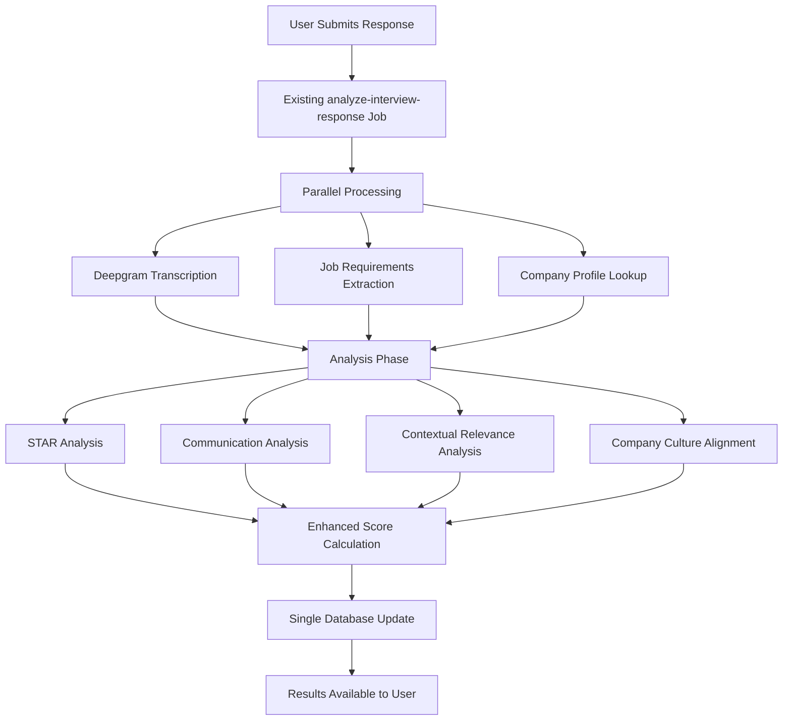

# AceYourHireVue: Contextual Scoring Enhancement Documentation

## Overview

This document outlines the implementation of two advanced scoring enhancements for AceYourHireVue's interview evaluation system:

1. **Company Culture Alignment Scoring** - Evaluates how well user responses align with specific company values and culture
2. **Contextual Relevance Scoring** - Assesses response relevance to job requirements and industry context

These enhancements integrate seamlessly with the existing STAR method and communication analysis, providing more comprehensive and targeted feedback without significant performance impact.

## Table of Contents

- [Project Structure Alignment](#project-structure-alignment)
- [Technical Architecture](#technical-architecture)
- [Database Schema Changes](#database-schema-changes)
- [Implementation Details](#implementation-details)
- [Integration with Existing System](#integration-with-existing-system)
- [Performance Optimization](#performance-optimization)
- [User Experience Impact](#user-experience-impact)
- [Implementation Roadmap](#implementation-roadmap)
- [Testing Strategy](#testing-strategy)

---

## Project Structure Alignment

This document has been updated to match your actual AceYourHireVue project structure:

### ✅ Database Schema (Already Implemented)
- **Company Profiles Table**: Already exists in `src/lib/db/schema.ts`
- **Contextual Scoring Columns**: Already added to `interview_answers` table
  - `contextualRelevanceScores: jsonb('contextual_relevance_scores')`
  - `companyAlignmentScores: jsonb('company_alignment_scores')`
  - `jobAlignmentBreakdown: jsonb('job_alignment_breakdown')`

### 📁 Directory Structure Updates
- **Trigger Jobs**: Located in `trigger/interviews/` (not `jobs/`)
- **Analysis Utilities**: Will be created in `src/lib/analysis/`
- **Components**: Will be created in `src/components/interviews/analysis/`
- **Tests**: Located in `src/tests/` (not root-level `tests/`)

### 🔧 Key Implementation Files
- **Main Analysis Job**: `trigger/interviews/job.ts`
- **Individual Analysis Tasks**: 
  - `trigger/interviews/analyse-star-task.ts`
  - `trigger/interviews/analyse-communication-task.ts` 
  - `trigger/interviews/analyse-contextual-task.ts`
  - `trigger/interviews/analyse-culture-task.ts`
- **Analysis Utilities**: `src/lib/analysis/` (to be created)
- **Enhanced UI Components**: `src/components/interviews/analysis/` (to be created)

---

## Technical Architecture

### System Flow Enhancement



### Core Components

1. **Company Research Pipeline** - Automated extraction of company values and culture
2. **Contextual Analysis Engine** - Job-specific relevance scoring
3. **Enhanced Scoring Algorithm** - Weighted combination of all analysis dimensions
4. **Intelligent Caching** - Performance optimization for repeated company lookups

---

## Database Schema Changes

### New Tables

```sql
-- Company Profiles Table
CREATE TABLE company_profiles (
    id uuid PRIMARY KEY DEFAULT uuid_generate_v4(),
    company_name text NOT NULL,
    domain text,
    industry text,
    size_category text, -- 'startup', 'mid-size', 'enterprise'
    
    -- Culture & Values Data
    core_values jsonb, -- [{"value": "Innovation", "description": "...", "intensity": 8}]
    culture_keywords text[], -- ["fast-paced", "collaborative", "data-driven"]
    leadership_style text, -- "democratic", "hierarchical", "flat"
    work_environment text, -- "remote-first", "hybrid", "in-office"
    
    -- Metadata
    last_researched_at timestamp,
    research_confidence_score float, -- 0.0 to 1.0
    source_urls text[],
    
    created_at timestamp DEFAULT now() NOT NULL,
    updated_at timestamp DEFAULT now() NOT NULL
);

-- Indexes for performance
CREATE INDEX idx_company_profiles_name ON company_profiles(company_name);
CREATE INDEX idx_company_profiles_research_date ON company_profiles(last_researched_at);
```

### Enhanced Existing Tables

```sql
-- Add new columns to existing interview_answers table
ALTER TABLE interview_answers ADD COLUMN IF NOT EXISTS contextual_relevance_scores jsonb;
ALTER TABLE interview_answers ADD COLUMN IF NOT EXISTS company_alignment_scores jsonb;
ALTER TABLE interview_answers ADD COLUMN IF NOT EXISTS job_alignment_breakdown jsonb;

-- Example of the new JSONB structure:
-- contextual_relevance_scores: {
--   "overall": 85,
--   "job_description_alignment": 88,
--   "skills_demonstration": 82,
--   "industry_knowledge": 87,
--   "role_competencies": 83
-- }

-- company_alignment_scores: {
--   "overall": 79,
--   "value_alignment": {"innovation": 85, "collaboration": 73},
--   "cultural_keyword_matches": ["data-driven", "customer-focused"],
--   "alignment_explanation": "Response demonstrates strong innovation mindset..."
-- }
```

---

## Implementation Details

### 1. Enhanced Analysis Tasks (Fan-Out Pattern)

```typescript
// trigger/interviews/analyse-star-task.ts - Individual Analysis Tasks

// STAR Method Analysis Task
export const analyzeSTARTask = task({
  id: "analyze-star-method",
  queue: {
    concurrencyLimit: 10
  },
  run: async (payload: {
    transcription: string;
    questionText: string;
    questionType: string;
    userTier: string;
  }) => {
    const { transcription, questionText, questionType, userTier } = payload;

    const starPrompt = getSTARAnalysisPrompt(userTier);
    
    const starAnalysis = await openai.chat.completions.create({
      model: userTier === 'pro' ? "gpt-4" : "gpt-4o-mini",
      messages: [{
        role: "system",
        content: starPrompt
      }, {
        role: "user",
        content: `QUESTION: ${questionText}\nRESPONSE: ${transcription}`
      }],
      response_format: { type: "json_object" }
    });

    return JSON.parse(starAnalysis.choices[0].message.content);
  }
});

// trigger/interviews/analyse-communication-task.ts
export const analyzeCommunicationTask = task({
  id: "analyze-communication",
  queue: {
    concurrencyLimit: 10
  },
  run: async (payload: {
    transcription: string;
    speechMetrics: any;
    userTier: string;
  }) => {
    const { transcription, speechMetrics, userTier } = payload;

    const communicationPrompt = getCommunicationAnalysisPrompt(userTier);
    
    const communicationAnalysis = await openai.chat.completions.create({
      model: userTier === 'pro' ? "gpt-4" : "gpt-4o-mini",
      messages: [{
        role: "system",
        content: communicationPrompt
      }, {
        role: "user",
        content: `TRANSCRIPTION: ${transcription}\nSPEECH_METRICS: ${JSON.stringify(speechMetrics)}`
      }],
      response_format: { type: "json_object" }
    });

    return JSON.parse(communicationAnalysis.choices[0].message.content);
  }
});

// trigger/interviews/analyse-contextual-task.ts
export const analyzeContextualRelevanceTask = task({
  id: "analyze-contextual-relevance",
  queue: {
    concurrencyLimit: 8
  },
  run: async (payload: {
    transcription: string;
    questionText: string;
    jobRequirements: any;
    questionType: string;
    userTier: string;
  }) => {
    const { transcription, questionText, jobRequirements, questionType, userTier } = payload;

    // Skip for free tier
    if (userTier === 'free' || !jobRequirements) {
      return null;
    }

    const contextualPrompt = getContextualScoringPrompt(userTier, questionType);
    
    const contextualScoring = await openai.chat.completions.create({
      model: userTier === 'pro' ? "gpt-4" : "gpt-4o-mini",
      messages: [{
        role: "system",
        content: contextualPrompt
      }, {
        role: "user",
        content: `
          QUESTION: ${questionText}
          RESPONSE: ${transcription}
          JOB_REQUIREMENTS: ${JSON.stringify(jobRequirements)}
          QUESTION_TYPE: ${questionType}
        `
      }],
      response_format: { type: "json_object" }
    });

    return JSON.parse(contextualScoring.choices[0].message.content);
  }
});

// trigger/interviews/analyse-culture-task.ts
export const analyzeCompanyCultureTask = task({
  id: "analyze-company-culture",
  queue: {
    concurrencyLimit: 8
  },
  run: async (payload: {
    transcription: string;
    questionText: string;
    companyProfile: any;
    userTier: string;
  }) => {
    const { transcription, questionText, companyProfile, userTier } = payload;

    // Skip for free tier or no company data
    if (userTier === 'free' || !companyProfile?.core_values) {
      return null;
    }

    const culturePrompt = getCultureAlignmentPrompt(userTier);
    
    const cultureAlignment = await openai.chat.completions.create({
      model: userTier === 'pro' ? "gpt-4" : "gpt-4o-mini",
      messages: [{
        role: "system",
        content: culturePrompt
      }, {
        role: "user",
        content: `
          QUESTION: ${questionText}
          RESPONSE: ${transcription}
          COMPANY_VALUES: ${JSON.stringify(companyProfile.core_values)}
          CULTURE_KEYWORDS: ${companyProfile.culture_keywords?.join(', ') || 'N/A'}
        `
      }],
      response_format: { type: "json_object" }
    });

    const alignmentData = JSON.parse(cultureAlignment.choices[0].message.content);
    
    return {
      company_profile_id: companyProfile.id,
      ...alignmentData
    };
  }
});
```

### 2. Enhanced Main Analysis Job (Fan-Out Orchestrator)

```typescript
// trigger/interviews/job.ts (Enhanced with batchTriggerAndWait)
export const analyzeInterviewResponse = task({
  id: "analyze-interview-response",
  name: "Analyze Interview Response with Contextual Scoring",
  version: "2.0.0",
  trigger: eventTrigger({
    name: "interview.response.submitted",
  }),
  run: async (payload, io, ctx) => {
    const { 
      answerId, 
      userId, 
      interviewId, 
      questionId,
      audioUrl,
      userTier 
    } = payload;

    try {
      // Step 1: Fetch Required Data
      const [audioData, userSubscription, questionData, interviewData] = await Promise.all([
        io.supabase.runTask("fetch-audio", {
          query: "SELECT audio_url FROM interview_answers WHERE id = $1",
          params: [answerId]
        }),
        io.supabase.runTask("fetch-subscription", {
          query: "SELECT subscription_tier FROM users WHERE id = $1",
          params: [userId]
        }),
        io.supabase.runTask("fetch-question", {
          query: `
            SELECT iq.question_text, iq.question_type 
            FROM interview_questions iq 
            WHERE iq.id = $1
          `,
          params: [questionId]
        }),
        io.supabase.runTask("fetch-interview", {
          query: `
            SELECT company_name, job_description, job_position 
            FROM interviews 
            WHERE id = $1
          `,
          params: [interviewId]
        })
      ]);

      // Step 2: Transcription and Context Preparation
      const deepgramConfig = getDeepgramConfig(userTier);
      
      const [transcriptionResult, jobRequirements, companyProfile] = await Promise.all([
        io.deepgram.transcribe("transcribe-audio", {
          url: audioData.data[0].audio_url,
          ...deepgramConfig
        }),
        extractJobRequirements(io, interviewData.data[0].job_description),
        getOrResearchCompanyProfile(io, interviewData.data[0].company_name)
      ]);

      const transcription = transcriptionResult.results.channels[0].alternatives[0].transcript;
      const speechMetrics = transcriptionResult.metadata;

      // Step 3: Fan-Out Analysis Using batchTriggerAndWait
      const analysisPayloads = [
        // STAR Analysis (always run)
        {
          task: "star",
          payload: {
            transcription,
            questionText: questionData.data[0].question_text,
            questionType: questionData.data[0].question_type,
            userTier
          }
        },
        
        // Communication Analysis (always run)
        {
          task: "communication",
          payload: {
            transcription,
            speechMetrics,
            userTier
          }
        }
      ];

      // Add contextual analysis for Standard/Pro tiers
      if (userTier !== 'free' && jobRequirements) {
        analysisPayloads.push({
          task: "contextual",
          payload: {
            transcription,
            questionText: questionData.data[0].question_text,
            jobRequirements,
            questionType: questionData.data[0].question_type,
            userTier
          }
        });
      }

      // Add company culture analysis for Standard/Pro tiers with company data
      if (userTier !== 'free' && companyProfile?.core_values) {
        analysisPayloads.push({
          task: "culture",
          payload: {
            transcription,
            questionText: questionData.data[0].question_text,
            companyProfile,
            userTier
          }
        });
      }

      // Execute all analysis tasks in parallel with proper error handling
      const batchPayloads = analysisPayloads.map(({ task, payload }) => {
        switch (task) {
          case "star":
            return { taskIdentifier: "star", payload };
          case "communication":
            return { taskIdentifier: "communication", payload };
          case "contextual":
            return { taskIdentifier: "contextual", payload };
          case "culture":
            return { taskIdentifier: "culture", payload };
        }
      });

      // Fan-out to analysis tasks
      const analysisResults = await Promise.all([
        analyzeSTARTask.batchTriggerAndWait(
          batchPayloads.filter(p => p.taskIdentifier === "star").map(p => p.payload)
        ),
        analyzeCommunicationTask.batchTriggerAndWait(
          batchPayloads.filter(p => p.taskIdentifier === "communication").map(p => p.payload)
        ),
        ...(userTier !== 'free' ? [
          analyzeContextualRelevanceTask.batchTriggerAndWait(
            batchPayloads.filter(p => p.taskIdentifier === "contextual").map(p => p.payload)
          ),
          analyzeCompanyCultureTask.batchTriggerAndWait(
            batchPayloads.filter(p => p.taskIdentifier === "culture").map(p => p.payload)
          )
        ] : [])
      ]);

      // Step 4: Process Results with Error Handling
      const processedResults = {
        starAnalysis: null,
        communicationAnalysis: null,
        contextualAnalysis: null,
        cultureAlignment: null,
        errors: []
      };

      // Process STAR analysis results
      const starResults = analysisResults[0];
      if (starResults?.runs?.[0]) {
        if (starResults.runs[0].ok) {
          processedResults.starAnalysis = starResults.runs[0].output;
        } else {
          processedResults.errors.push(`STAR analysis failed: ${starResults.runs[0].error}`);
          await io.logger.error("STAR analysis failed", { 
            error: starResults.runs[0].error,
            answerId 
          });
        }
      }

      // Process Communication analysis results
      const communicationResults = analysisResults[1];
      if (communicationResults?.runs?.[0]) {
        if (communicationResults.runs[0].ok) {
          processedResults.communicationAnalysis = communicationResults.runs[0].output;
        } else {
          processedResults.errors.push(`Communication analysis failed: ${communicationResults.runs[0].error}`);
          await io.logger.error("Communication analysis failed", { 
            error: communicationResults.runs[0].error,
            answerId 
          });
        }
      }

      // Process Contextual analysis results (if applicable)
      if (analysisResults[2]?.runs?.[0]) {
        if (analysisResults[2].runs[0].ok) {
          processedResults.contextualAnalysis = analysisResults[2].runs[0].output;
        } else {
          processedResults.errors.push(`Contextual analysis failed: ${analysisResults[2].runs[0].error}`);
          await io.logger.warn("Contextual analysis failed", { 
            error: analysisResults[2].runs[0].error,
            answerId 
          });
          // Don't fail entire job for contextual analysis
        }
      }

      // Process Culture alignment results (if applicable)
      if (analysisResults[3]?.runs?.[0]) {
        if (analysisResults[3].runs[0].ok) {
          processedResults.cultureAlignment = analysisResults[3].runs[0].output;
        } else {
          processedResults.errors.push(`Culture alignment failed: ${analysisResults[3].runs[0].error}`);
          await io.logger.warn("Culture alignment failed", { 
            error: analysisResults[3].runs[0].error,
            answerId 
          });
          // Don't fail entire job for culture analysis
        }
      }

      // Fail only if core analyses (STAR or Communication) failed
      if (!processedResults.starAnalysis || !processedResults.communicationAnalysis) {
        throw new Error(`Core analysis failed: ${processedResults.errors.join(', ')}`);
      }

      // Step 5: Calculate Enhanced Overall Score
      const enhancedOverallScore = calculateEnhancedOverallScore({
        starAnalysis: processedResults.starAnalysis,
        communicationAnalysis: processedResults.communicationAnalysis,
        contextualAnalysis: processedResults.contextualAnalysis,
        cultureAlignment: processedResults.cultureAlignment,
        userTier,
        questionType: questionData.data[0].question_type
      });

      // Step 6: Generate Comprehensive Improvement Suggestions
      const improvementSuggestions = generateEnhancedSuggestions({
        starAnalysis: processedResults.starAnalysis,
        communicationAnalysis: processedResults.communicationAnalysis,
        contextualAnalysis: processedResults.contextualAnalysis,
        cultureAlignment: processedResults.cultureAlignment,
        userTier
      });

      // Step 7: Store Results
      await io.supabase.runTask("store-enhanced-analysis", {
        query: `
          UPDATE interview_answers 
          SET 
            overall_score = $1,
            star_scores = $2,
            communication_scores = $3,
            content_scores = $4,
            speech_metrics = $5,
            improvement_suggestions = $6,
            transcription = $7,
            contextual_relevance_scores = $8,
            company_alignment_scores = $9,
            job_alignment_breakdown = $10,
            analyzed_at = NOW(),
            updated_at = NOW()
          WHERE id = $11
        `,
        params: [
          enhancedOverallScore,
          processedResults.starAnalysis,
          processedResults.communicationAnalysis,
          processedResults.contextualAnalysis,
          speechMetrics,
          improvementSuggestions,
          transcription,
          processedResults.contextualAnalysis,
          processedResults.cultureAlignment,
          jobRequirements,
          answerId
        ]
      });

      return {
        success: true,
        overallScore: enhancedOverallScore,
        hasContextualAnalysis: !!processedResults.contextualAnalysis,
        hasCultureAlignment: !!processedResults.cultureAlignment,
        errors: processedResults.errors,
        processingTime: Date.now() - ctx.run.startedAt.getTime()
      };

    } catch (error) {
      await io.logger.error("Enhanced analysis completely failed", { 
        error: error.message, 
        answerId,
        stack: error.stack 
      });
      throw error;
    }
  }
});
```

### 2. Company Research Functions

```typescript
// src/lib/analysis/company-research.ts
export async function getOrResearchCompanyProfile(
  io: any, 
  companyName: string
): Promise<any> {
  if (!companyName) return null;

  // Check for existing, recent profile
  const existingProfile = await io.supabase.runTask("check-company-profile", {
    query: `
      SELECT * FROM company_profiles 
      WHERE company_name ILIKE $1 
      AND last_researched_at > NOW() - INTERVAL '7 days'
      AND research_confidence_score > 0.6
    `,
    params: [companyName]
  });

  if (existingProfile.data?.[0]) {
    return existingProfile.data[0];
  }

  // Research company if not found or stale
  return await researchCompanyValues(io, companyName);
}

async function researchCompanyValues(io: any, companyName: string) {
  try {
    // Web search for company information
    const searchQueries = [
      `${companyName} company values mission culture`,
      `${companyName} workplace culture employee experience`,
      `${companyName} leadership principles core values`
    ];

    const searchResults = [];
    for (const query of searchQueries) {
      const result = await io.runTask(`search-company-${companyName}`, async () => {
        // Use web_search function here
        return await webSearch({ query });
      });
      searchResults.push(result);
    }

    // Extract values using LLM
    const valuesExtraction = await io.openai.chat.completions.create(
      "extract-company-values",
      {
        model: "gpt-4o-mini", // Cost-effective for extraction
        messages: [{
          role: "system",
          content: `Analyze company information and extract:
            1. Core company values (3-6 key values)
            2. Cultural keywords and descriptors
            3. Leadership style indicators
            4. Work environment preferences
            5. Confidence score (0.0-1.0) based on information quality
            
            Return structured JSON. If insufficient information, return confidence < 0.5.`
        }, {
          role: "user",
          content: `Company: ${companyName}\n\nSearch Results:\n${JSON.stringify(searchResults, null, 2)}`
        }],
        response_format: { type: "json_object" }
      }
    );

    const extractedData = JSON.parse(valuesExtraction.choices[0].message.content);

    // Store company profile
    const companyProfile = await io.supabase.runTask("store-company-profile", {
      query: `
        INSERT INTO company_profiles (
          company_name, core_values, culture_keywords, 
          leadership_style, work_environment, 
          last_researched_at, research_confidence_score, source_urls
        ) VALUES ($1, $2, $3, $4, $5, NOW(), $6, $7)
        ON CONFLICT (company_name) 
        DO UPDATE SET
          core_values = $2,
          culture_keywords = $3,
          leadership_style = $4,
          work_environment = $5,
          last_researched_at = NOW(),
          research_confidence_score = $6,
          source_urls = $7,
          updated_at = NOW()
        RETURNING *
      `,
      params: [
        companyName,
        extractedData.core_values || [],
        extractedData.culture_keywords || [],
        extractedData.leadership_style || null,
        extractedData.work_environment || null,
        extractedData.confidence_score || 0.5,
        searchResults.map(r => r.url).filter(Boolean)
      ]
    });

    return companyProfile.data[0];

  } catch (error) {
    await io.logger.warn("Company research failed", { 
      companyName, 
      error: error.message 
    });
    return null;
  }
}
```

### 3. Contextual Relevance Analysis

```typescript
// src/lib/analysis/contextual-analysis.ts
export async function analyzeContextualRelevance(
  io: any,
  { transcription, questionText, jobRequirements, questionType, userTier }: {
    transcription: string;
    questionText: string;
    jobRequirements: any;
    questionType: string;
    userTier: string;
  }
) {
  // Skip contextual analysis for free tier
  if (userTier === 'free' || !jobRequirements) {
    return null;
  }

  const contextualPrompt = getContextualScoringPrompt(userTier, questionType);
  
  const contextualScoring = await io.openai.chat.completions.create(
    "score-contextual-relevance",
    {
      model: userTier === 'pro' ? "gpt-4" : "gpt-4o-mini",
      messages: [{
        role: "system",
        content: contextualPrompt
      }, {
        role: "user",
        content: `
          QUESTION: ${questionText}
          RESPONSE: ${transcription}
          JOB REQUIREMENTS: ${JSON.stringify(jobRequirements)}
          QUESTION TYPE: ${questionType}
        `
      }],
      response_format: { type: "json_object" }
    }
  );

  const scoringData = JSON.parse(contextualScoring.choices[0].message.content);

  return {
    overall: scoringData.overall_score || 0,
    job_description_alignment: scoringData.job_alignment || 0,
    skills_demonstration: scoringData.skills_demonstration || 0,
    industry_knowledge: scoringData.industry_knowledge || 0,
    role_competencies: scoringData.role_competencies || 0,
    detailed_feedback: scoringData.feedback || "",
    improvement_areas: scoringData.improvement_areas || []
  };
}

function getContextualScoringPrompt(userTier: string, questionType: string): string {
  const basePrompt = `
    Evaluate this interview response on contextual relevance to the job requirements.
    
    SCORING CRITERIA (0-100 each):
    1. Job Description Alignment - How well response matches job requirements
    2. Skills Demonstration - Evidence of required skills and experience
    3. Industry Knowledge - Understanding of industry context and challenges
    4. Role Competencies - Demonstration of role-specific abilities
    
    Calculate overall score as weighted average.
  `;

  if (userTier === 'pro') {
    return basePrompt + `
      ADDITIONAL PRO ANALYSIS:
      - Provide specific examples from the response
      - Identify missing elements from job requirements
      - Suggest specific improvements for better alignment
      - Analyze depth of industry knowledge demonstrated
      
      Return detailed JSON with explanations and specific recommendations.
    `;
  }

  return basePrompt + `
    Return JSON with scores and brief feedback for each dimension.
  `;
}
```

### 4. Company Culture Alignment Analysis

```typescript
// src/lib/analysis/culture-analysis.ts
export async function analyzeCompanyCultureAlignment(
  io: any,
  { transcription, questionText, companyProfile, userTier }: {
    transcription: string;
    questionText: string;
    companyProfile: any;
    userTier: string;
  }
) {
  // Only for Standard/Pro tiers and when company data is available
  if (userTier === 'free' || !companyProfile?.core_values) {
    return null;
  }

  const culturePrompt = getCultureAlignmentPrompt(userTier);
  
  const cultureAlignment = await io.openai.chat.completions.create(
    "analyze-culture-alignment",
    {
      model: userTier === 'pro' ? "gpt-4" : "gpt-4o-mini",
      messages: [{
        role: "system",
        content: culturePrompt
      }, {
        role: "user",
        content: `
          QUESTION: ${questionText}
          RESPONSE: ${transcription}
          COMPANY VALUES: ${JSON.stringify(companyProfile.core_values)}
          CULTURE KEYWORDS: ${companyProfile.culture_keywords?.join(', ') || 'N/A'}
          LEADERSHIP STYLE: ${companyProfile.leadership_style || 'N/A'}
        `
      }],
      response_format: { type: "json_object" }
    }
  );

  const alignmentData = JSON.parse(cultureAlignment.choices[0].message.content);

  return {
    company_profile_id: companyProfile.id,
    overall: alignmentData.overall_alignment || 0,
    value_alignment: alignmentData.value_scores || {},
    cultural_keyword_matches: alignmentData.keyword_matches || [],
    alignment_explanation: alignmentData.explanation || "",
    improvement_suggestions: alignmentData.culture_improvements || [],
    company_values_referenced: companyProfile.core_values
  };
}

function getCultureAlignmentPrompt(userTier: string): string {
  const basePrompt = `
    Analyze how well this interview response aligns with the company's stated values and culture.
    
    EVALUATION CRITERIA:
    1. Value Alignment - How well response demonstrates company values
    2. Cultural Fit - Alignment with company culture and work style
    3. Language Alignment - Use of cultural keywords and terminology
    
    Score overall alignment (0-100) and individual value alignment.
  `;

  if (userTier === 'pro') {
    return basePrompt + `
      ADVANCED PRO ANALYSIS:
      - Identify specific value demonstrations in the response
      - Highlight cultural misalignments and explain why
      - Provide specific suggestions to better align with company culture
      - Analyze leadership style compatibility
      
      Return detailed JSON with specific examples and actionable recommendations.
    `;
  }

  return basePrompt + `
    Return JSON with scores and brief alignment explanation.
  `;
}
```

### 5. Enhanced Scoring Algorithm

```typescript
// src/lib/analysis/enhanced-scoring.ts
export function calculateEnhancedOverallScore({
  starAnalysis,
  communicationAnalysis,
  contextualAnalysis,
  cultureAlignment,
  userTier,
  questionType
}: {
  starAnalysis: any;
  communicationAnalysis: any;
  contextualAnalysis: any;
  cultureAlignment: any;
  userTier: string;
  questionType: string;
}): number {
  const weights = getScoreWeights(userTier, questionType);
  
  let totalScore = 0;
  let totalWeight = 0;

  // STAR analysis (always present)
  if (starAnalysis?.overall_star_score) {
    totalScore += starAnalysis.overall_star_score * weights.star;
    totalWeight += weights.star;
  }

  // Communication analysis (always present)
  if (communicationAnalysis?.overall_score) {
    totalScore += communicationAnalysis.overall_score * weights.communication;
    totalWeight += weights.communication;
  }

  // Contextual relevance (Standard/Pro only)
  if (contextualAnalysis?.overall) {
    totalScore += contextualAnalysis.overall * weights.contextual;
    totalWeight += weights.contextual;
  }

  // Culture alignment (Standard/Pro only)
  if (cultureAlignment?.overall) {
    totalScore += cultureAlignment.overall * weights.culture;
    totalWeight += weights.culture;
  }

  // Normalize based on available components
  return Math.round(totalScore / totalWeight);
}

function getScoreWeights(userTier: string, questionType: string) {
  // Base weights for different tiers
  const tierWeights = {
    free: {
      star: 0.55,
      communication: 0.45,
      contextual: 0,
      culture: 0
    },
    standard: {
      star: 0.35,
      communication: 0.25,
      contextual: 0.25,
      culture: 0.15
    },
    pro: {
      star: 0.30,
      communication: 0.20,
      contextual: 0.25,
      culture: 0.25
    }
  };

  let weights = tierWeights[userTier] || tierWeights.free;

  // Adjust weights based on question type
  if (userTier !== 'free') {
    switch (questionType) {
      case 'behavioral':
        weights = {
          ...weights,
          star: 0.40,
          culture: 0.30,
          contextual: 0.20
        };
        break;
      
      case 'technical':
        weights = {
          ...weights,
          contextual: 0.35,
          star: 0.25,
          culture: 0.15
        };
        break;
      
      case 'leadership':
        weights = {
          ...weights,
          culture: 0.35,
          star: 0.30,
          contextual: 0.20
        };
        break;
    }
  }

  return weights;
}
```

---

## Integration with Existing System

### Backward Compatibility

- All existing functionality remains unchanged
- New scoring dimensions are additive, not replacing existing scores
- Free tier users continue to receive basic STAR and communication analysis
- Existing database records are not affected

### Tier-Based Feature Distribution

| Feature | Free | Standard | Pro |
|---------|------|----------|-----|
| STAR Method Analysis | ✅ Basic | ✅ Detailed | ✅ Advanced |
| Communication Analysis | ✅ Basic | ✅ Detailed | ✅ Advanced |
| Contextual Relevance | ❌ | ✅ | ✅ Enhanced |
| Company Culture Alignment | ❌ | ✅ Basic | ✅ Advanced |
| Job Requirements Extraction | ❌ | ✅ | ✅ |
| Industry Benchmarking | ❌ | ❌ | ✅ |

### API Response Enhancement

```typescript
// Enhanced API response structure
interface EnhancedAnalysisResponse {
  // Existing fields
  overall_score: number;
  star_scores: STARScores;
  communication_scores: CommunicationScores;
  speech_metrics: SpeechMetrics;
  improvement_suggestions: string[];
  
  // New fields
  contextual_relevance_scores?: ContextualScores;
  company_alignment_scores?: CultureAlignment;
  job_alignment_breakdown?: JobRequirements;
  enhanced_feedback?: {
    strengths: string[];
    improvement_areas: string[];
    specific_recommendations: string[];
  };
}

interface ContextualScores {
  overall: number;
  job_description_alignment: number;
  skills_demonstration: number;
  industry_knowledge: number;
  role_competencies: number;
  detailed_feedback: string;
}

interface CultureAlignment {
  overall: number;
  value_alignment: Record<string, number>;
  cultural_keyword_matches: string[];
  alignment_explanation: string;
  company_values_referenced: CompanyValue[];
}
```

---

## Performance Optimization

### Caching Strategy

1. **Company Profiles**: 7-day cache with confidence score validation
2. **Job Requirements**: Cache extracted requirements per job description hash
3. **LLM Prompts**: Template caching for consistent prompts
4. **Database Queries**: Optimized indexes for company lookups

### Fan-Out Processing with batchTriggerAndWait

```typescript
// Optimized fan-out processing flow
const PROCESSING_STRATEGY = {
  // Stage 1: Data preparation (parallel)
  preparation: [
    'deepgram_transcription',
    'job_requirements_extraction', 
    'company_profile_lookup'
  ],
  
  // Stage 2: Analysis fan-out (batchTriggerAndWait)
  analysis_fanout: {
    core_tasks: ['star_analysis', 'communication_analysis'], // Always run
    enhanced_tasks: ['contextual_analysis', 'culture_alignment'], // Tier-dependent
    concurrency_limits: {
      star_analysis: 10,
      communication_analysis: 10,
      contextual_analysis: 8,
      culture_alignment: 8
    }
  },
  
  // Stage 3: Results aggregation (sequential)
  aggregation: [
    'error_handling',
    'score_calculation', 
    'suggestion_generation',
    'database_update'
  ]
};

// Error handling strategy for batch operations
const BATCH_ERROR_STRATEGY = {
  core_analysis_failure: 'FAIL_ENTIRE_JOB', // STAR/Communication must succeed
  enhanced_analysis_failure: 'LOG_AND_CONTINUE', // Contextual/Culture can fail gracefully
  retry_strategy: {
    max_attempts: 3,
    backoff_strategy: 'exponential'
  }
};
```

### Expected Performance Metrics

- **Additional Processing Time**: 4-6 seconds (fan-out pattern reduces sequential delays)
- **Success Rate Target**: >95% (improved error handling with graceful degradation)
- **Cache Hit Rate**: >80% for company profiles
- **LLM Token Usage**: ~500-1000 additional tokens per analysis
- **Concurrency Benefits**: 
  - STAR + Communication analysis: Parallel execution
  - Enhanced analyses: Batch processing with controlled concurrency
  - Error isolation: Individual task failures don't crash entire pipeline

### Benefits of batchTriggerAndWait Implementation

1. **Superior Error Handling**
   - Individual task failure tracking with `.ok` property
   - Granular error information for debugging
   - Graceful degradation for non-critical analyses
   - Core vs. enhanced analysis failure differentiation

2. **Optimal Concurrency Control**
   - Task-specific concurrency limits prevent resource overload
   - Built-in queuing and backpressure handling
   - Better resource utilization across analysis tasks

3. **Improved Observability**
   - Individual task performance tracking
   - Detailed error logging per analysis component
   - Clear success/failure metrics for monitoring

4. **Trigger.dev Best Practices**
   - Follows recommended fan-out pattern
   - Proper task isolation and reusability
   - Enhanced debugging and retry capabilities

```typescript
// Performance monitoring example
const performanceMetrics = {
  total_analysis_time: result.processingTime,
  individual_task_times: {
    star_analysis: starResults.runs[0]?.duration,
    communication_analysis: communicationResults.runs[0]?.duration,
    contextual_analysis: contextualResults?.runs[0]?.duration,
    culture_alignment: cultureResults?.runs[0]?.duration
  },
  success_rates: {
    core_analyses: (starSuccess && communicationSuccess) ? 1.0 : 0.0,
    enhanced_analyses: enhancedSuccessCount / enhancedTotalCount
  },
  error_breakdown: processedResults.errors
};
```

---

## User Experience Impact

### Enhanced Feedback Interface

```tsx
// src/components/interviews/analysis/enhanced-feedback.tsx
interface EnhancedFeedbackProps {
  analysis: EnhancedAnalysisResponse;
  userTier: string;
}

export function EnhancedFeedback({ analysis, userTier }: EnhancedFeedbackProps) {
  return (
    <div className="space-y-8" data-testid="enhanced-feedback-container">
      {/* Existing STAR and Communication sections */}
      <STARMethodFeedback 
        scores={analysis.star_scores}
        data-testid="star-feedback-section"
      />
      
      <CommunicationFeedback 
        scores={analysis.communication_scores}
        data-testid="communication-feedback-section"
      />

      {/* New Contextual Relevance section (Standard/Pro) */}
      {analysis.contextual_relevance_scores && userTier !== 'free' && (
        <ContextualRelevanceFeedback 
          scores={analysis.contextual_relevance_scores}
          jobAlignment={analysis.job_alignment_breakdown}
          data-testid="contextual-relevance-section"
        />
      )}

      {/* New Company Culture section (Standard/Pro) */}
      {analysis.company_alignment_scores && userTier !== 'free' && (
        <CompanyCultureFeedback 
          alignment={analysis.company_alignment_scores}
          data-testid="company-culture-section"
        />
      )}

      {/* Enhanced Overall Summary */}
      <EnhancedSummary 
        analysis={analysis}
        userTier={userTier}
        data-testid="enhanced-summary-section"
      />
    </div>
  );
}
```

### Progressive Disclosure

- Free tier users see upgrade prompts for advanced features
- Standard tier gets basic contextual and culture analysis
- Pro tier receives comprehensive analysis with specific recommendations

---

## Implementation Roadmap

### Phase 1: Foundation (Week 1-2)
- [x] Database schema updates and migrations (✅ Already completed)
- [x] Company profiles table creation (✅ Already exists in schema.ts)
- [ ] Individual analysis task creation (STAR, Communication, Contextual, Culture)
- [ ] Basic company research pipeline with caching
- [ ] Enhanced job schema integration

### Phase 2: Core Analysis & Fan-Out (Week 2-3)
- [ ] Implement batchTriggerAndWait orchestration in trigger/interviews/job.ts
- [ ] Create src/lib/analysis/ directory and utility files
- [ ] Contextual relevance analysis task in trigger/interviews/analyse-contextual-task.ts
- [ ] Company culture alignment analysis task in trigger/interviews/analyse-culture-task.ts
- [ ] Enhanced scoring algorithm with weighted calculations
- [ ] Error handling strategy for batch operations
- [ ] Concurrency limit optimization per task type

### Phase 3: Performance & Reliability (Week 3-4)
- [ ] Company profile caching implementation
- [ ] Performance optimization and load testing
- [ ] Comprehensive error handling and fallback strategies
- [ ] Monitoring and observability for batch operations
- [ ] Task retry and failure recovery mechanisms

### Phase 4: UI & User Experience (Week 4-5)
- [ ] Create src/components/interviews/analysis/ directory
- [ ] Enhanced feedback components for new scoring dimensions
- [ ] Update existing dashboard components in src/components/dashboard/
- [ ] Tier-based feature display and upgrade prompts
- [ ] Analytics dashboard updates with new metrics
- [ ] User onboarding updates for contextual features
- [ ] A/B testing setup for scoring accuracy validation

### Phase 5: Launch & Monitor (Week 5-6)
- [ ] Production deployment with feature flags
- [ ] Real-time performance monitoring and alerting
- [ ] User feedback collection and analysis
- [ ] Batch operation success rate monitoring
- [ ] Iterative improvements based on usage patterns

### Key Implementation Considerations

**batchTriggerAndWait Specific Setup:**
- Configure appropriate concurrency limits per analysis type
- Implement proper error handling for each batch result
- Set up monitoring for individual task performance
- Plan for graceful degradation when enhanced analyses fail

**Testing Strategy for Batch Operations:**
- Unit tests for individual analysis tasks
- Integration tests for batch orchestration
- Performance tests for concurrency limits
- Error scenario testing for partial failures

**Rollout Strategy:**
- Feature flag control for enabling enhanced scoring
- Gradual tier-based rollout (Pro → Standard → Free upgrades)
- Monitoring dashboard for batch operation health
- Quick rollback capability if issues arise

---

## Testing Strategy

### Unit Tests

```typescript
// src/tests/analysis/contextual-analysis.test.ts
describe('Contextual Analysis', () => {
  test('should analyze job alignment correctly', async () => {
    const mockTranscription = "I led a team of developers...";
    const mockJobRequirements = {
      required_skills: ["leadership", "javascript"],
      experience_level: "senior"
    };

    const result = await analyzeContextualRelevanceTask.testRun({
      transcription: mockTranscription,
      questionText: "Tell me about your leadership experience",
      jobRequirements: mockJobRequirements,
      questionType: "behavioral",
      userTier: "pro"
    });

    expect(result.overall).toBeGreaterThan(0);
    expect(result.skills_demonstration).toBeDefined();
    expect(result.job_description_alignment).toBeDefined();
  });

  test('should return null for free tier', async () => {
    const result = await analyzeContextualRelevanceTask.testRun({
      transcription: "test",
      questionText: "test", 
      jobRequirements: {},
      questionType: "behavioral",
      userTier: "free"
    });

    expect(result).toBeNull();
  });
});
```

### Batch Operation Tests

```typescript
// src/tests/integration/batch-analysis.test.ts
describe('Batch Analysis Operations', () => {
  test('should handle successful batch operations', async () => {
    const batchPayloads = [
      {
        transcription: "I successfully led a project...",
        questionText: "Describe a leadership experience",
        questionType: "behavioral",
        userTier: "pro"
      }
    ];

    const result = await analyzeSTARTask.batchTriggerAndWait(batchPayloads);

    expect(result.runs).toHaveLength(1);
    expect(result.runs[0].ok).toBe(true);
    expect(result.runs[0].output).toBeDefined();
  });

  test('should handle batch failures gracefully', async () => {
    const batchPayloads = [
      {
        transcription: "", // Invalid input
        questionText: "Test question",
        questionType: "behavioral", 
        userTier: "pro"
      }
    ];

    const result = await analyzeSTARTask.batchTriggerAndWait(batchPayloads);

    expect(result.runs).toHaveLength(1);
    
    if (!result.runs[0].ok) {
      expect(result.runs[0].error).toBeDefined();
      // Should not throw, just return error information
    }
  });

  test('should respect concurrency limits', async () => {
    const batchPayloads = Array(15).fill(null).map((_, i) => ({
      transcription: `Test transcription ${i}`,
      questionText: "Test question",
      questionType: "behavioral",
      userTier: "pro"
    }));

    const startTime = Date.now();
    const result = await analyzeSTARTask.batchTriggerAndWait(batchPayloads);
    const duration = Date.now() - startTime;

    expect(result.runs).toHaveLength(15);
    // With concurrency limit of 10, should take longer than if all ran at once
    expect(duration).toBeGreaterThan(1000); // Rough estimate
  });
});
```

### Integration Tests

```typescript
// src/tests/integration/enhanced-analysis.test.ts
describe('Enhanced Analysis Integration', () => {
  test('should complete full analysis pipeline with fan-out', async () => {
    const mockPayload = {
      answerId: 'test-answer-id',
      userId: 'test-user-id',
      interviewId: 'test-interview-id',
      questionId: 'test-question-id',
      audioUrl: 'test-audio-url',
      userTier: 'pro'
    };

    const result = await analyzeInterviewResponse.testRun(mockPayload);

    expect(result.success).toBe(true);
    expect(result.overallScore).toBeGreaterThan(0);
    expect(result.hasContextualAnalysis).toBe(true);
    expect(result.errors).toBeDefined(); // Should track any component errors
  });

  test('should handle core analysis failure', async () => {
    // Mock STAR analysis failure
    jest.spyOn(analyzeSTARTask, 'batchTriggerAndWait').mockResolvedValue({
      runs: [{
        ok: false,
        error: 'STAR analysis failed',
        id: 'test-run-id'
      }]
    });

    const mockPayload = {
      answerId: 'test-answer-id',
      userId: 'test-user-id', 
      interviewId: 'test-interview-id',
      questionId: 'test-question-id',
      audioUrl: 'test-audio-url',
      userTier: 'pro'
    };

    await expect(
      analyzeInterviewResponse.testRun(mockPayload)
    ).rejects.toThrow('Core analysis failed');
  });

  test('should continue despite enhanced analysis failures', async () => {
    // Mock contextual analysis failure but STAR/communication success
    jest.spyOn(analyzeContextualRelevanceTask, 'batchTriggerAndWait').mockResolvedValue({
      runs: [{
        ok: false,
        error: 'Contextual analysis failed',
        id: 'test-run-id'
      }]
    });

    jest.spyOn(analyzeSTARTask, 'batchTriggerAndWait').mockResolvedValue({
      runs: [{
        ok: true,
        output: { overall_star_score: 85 },
        id: 'test-run-id'
      }]
    });

    jest.spyOn(analyzeCommunicationTask, 'batchTriggerAndWait').mockResolvedValue({
      runs: [{
        ok: true,
        output: { overall_score: 80 },
        id: 'test-run-id'
      }]
    });

    const mockPayload = {
      answerId: 'test-answer-id',
      userId: 'test-user-id',
      interviewId: 'test-interview-id', 
      questionId: 'test-question-id',
      audioUrl: 'test-audio-url',
      userTier: 'pro'
    };

    const result = await analyzeInterviewResponse.testRun(mockPayload);

    expect(result.success).toBe(true);
    expect(result.hasContextualAnalysis).toBe(false);
    expect(result.errors).toContain('Contextual analysis failed');
  });
});
```

### Performance Tests

```typescript
// src/tests/integration/batch-performance.test.ts
describe('Batch Analysis Performance', () => {
  test('should complete batch operations within time limits', async () => {
    const batchSize = 5;
    const payloads = Array(batchSize).fill(null).map((_, i) => ({
      transcription: `Test response ${i}`,
      questionText: "Test question",
      questionType: "behavioral", 
      userTier: "pro"
    }));

    const startTime = Date.now();
    const result = await analyzeSTARTask.batchTriggerAndWait(payloads);
    const duration = Date.now() - startTime;

    expect(result.runs).toHaveLength(batchSize);
    expect(duration).toBeLessThan(30000); // 30 seconds max for batch
    
    // Check success rate
    const successRate = result.runs.filter(run => run.ok).length / batchSize;
    expect(successRate).toBeGreaterThan(0.9); // 90% success rate
  });

  test('should handle high concurrency efficiently', async () => {
    const highConcurrencyBatch = Array(20).fill(null).map((_, i) => ({
      transcription: `High concurrency test ${i}`,
      questionText: "Test question",
      questionType: "behavioral",
      userTier: "standard"
    }));

    const startTime = Date.now();
    const result = await analyzeSTARTask.batchTriggerAndWait(highConcurrencyBatch);
    const duration = Date.now() - startTime;

    expect(result.runs).toHaveLength(20);
    
    // Should complete faster than sequential processing
    const estimatedSequentialTime = 20 * 3000; // 3s per task
    expect(duration).toBeLessThan(estimatedSequentialTime * 0.6); // At least 40% faster
  });
});
```

---

## Monitoring and Analytics

### Key Metrics to Track

1. **Performance Metrics**
   - Analysis completion time
   - Cache hit rates
   - Error rates by component
   - LLM token usage

2. **Business Metrics**
   - User engagement with enhanced feedback
   - Tier conversion rates
   - Feature utilization by tier
   - User satisfaction scores

3. **Technical Metrics**
   - Database query performance
   - Company research success rates
   - Analysis accuracy feedback
   - System resource utilization

### Error Handling Strategy

```typescript
// Error handling with graceful degradation
async function analyzeWithFallback(analysisFunction: Function, fallbackValue: any) {
  try {
    return await analysisFunction();
  } catch (error) {
    await logError('Analysis component failed', { 
      error: error.message,
      component: analysisFunction.name 
    });
    return fallbackValue;
  }
}
```

---

This enhancement will significantly differentiate AceYourHireVue by providing company-specific and context-aware interview preparation that adapts to each user's target role and company culture, making it an invaluable tool for serious job seekers.