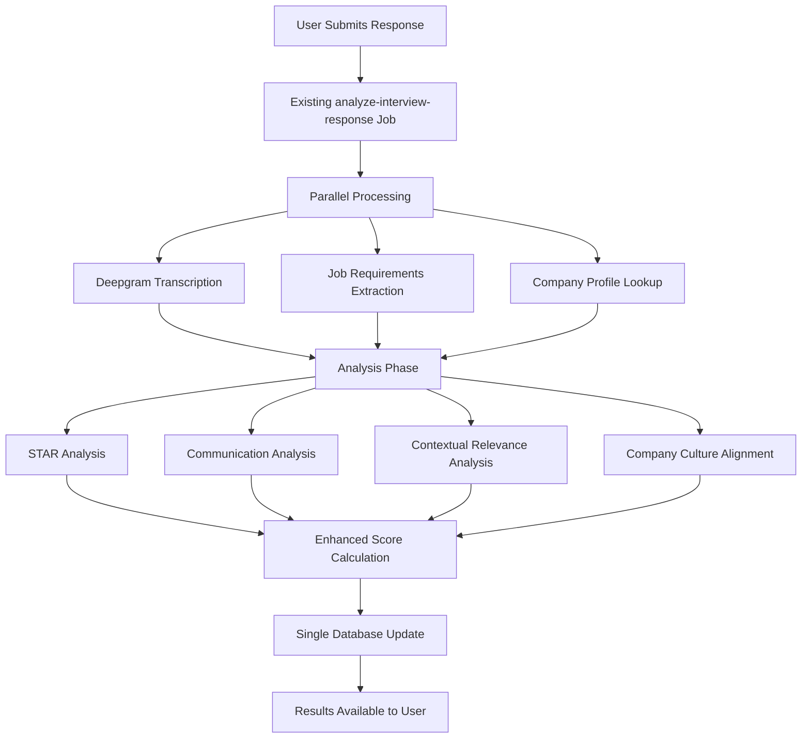

# AceYourHireVue: Contextual Scoring Enhancement Documentation

## Overview

This document outlines the implementation of two advanced scoring enhancements for AceYourHireVue's interview evaluation system:

1. **Company Culture Alignment Scoring** - Evaluates how well user responses align with specific company values and culture
2. **Contextual Relevance Scoring** - Assesses response relevance to job requirements and industry context

These enhancements integrate seamlessly with the existing STAR method and communication analysis, providing more comprehensive and targeted feedback without significant performance impact.

## Table of Contents

- [Technical Architecture](#technical-architecture)
- [Database Schema Changes](#database-schema-changes)
- [Implementation Details](#implementation-details)
- [Integration with Existing System](#integration-with-existing-system)
- [Performance Optimization](#performance-optimization)
- [User Experience Impact](#user-experience-impact)
- [Implementation Roadmap](#implementation-roadmap)
- [Testing Strategy](#testing-strategy)

---

## Technical Architecture

### System Flow Enhancement



### Core Components

1. **Company Research Pipeline** - Automated extraction of company values and culture
2. **Contextual Analysis Engine** - Job-specific relevance scoring
3. **Enhanced Scoring Algorithm** - Weighted combination of all analysis dimensions
4. **Intelligent Caching** - Performance optimization for repeated company lookups

---

## Database Schema Changes

### New Tables

```sql
-- Company Profiles Table
CREATE TABLE company_profiles (
    id uuid PRIMARY KEY DEFAULT uuid_generate_v4(),
    company_name text NOT NULL,
    domain text,
    industry text,
    size_category text, -- 'startup', 'mid-size', 'enterprise'
    
    -- Culture & Values Data
    core_values jsonb, -- [{"value": "Innovation", "description": "...", "intensity": 8}]
    culture_keywords text[], -- ["fast-paced", "collaborative", "data-driven"]
    leadership_style text, -- "democratic", "hierarchical", "flat"
    work_environment text, -- "remote-first", "hybrid", "in-office"
    
    -- Metadata
    last_researched_at timestamp,
    research_confidence_score float, -- 0.0 to 1.0
    source_urls text[],
    
    created_at timestamp DEFAULT now() NOT NULL,
    updated_at timestamp DEFAULT now() NOT NULL
);

-- Indexes for performance
CREATE INDEX idx_company_profiles_name ON company_profiles(company_name);
CREATE INDEX idx_company_profiles_research_date ON company_profiles(last_researched_at);
```

### Enhanced Existing Tables

```sql
-- Add new columns to existing interview_answers table
ALTER TABLE interview_answers ADD COLUMN IF NOT EXISTS contextual_relevance_scores jsonb;
ALTER TABLE interview_answers ADD COLUMN IF NOT EXISTS company_alignment_scores jsonb;
ALTER TABLE interview_answers ADD COLUMN IF NOT EXISTS job_alignment_breakdown jsonb;

-- Example of the new JSONB structure:
-- contextual_relevance_scores: {
--   "overall": 85,
--   "job_description_alignment": 88,
--   "skills_demonstration": 82,
--   "industry_knowledge": 87,
--   "role_competencies": 83
-- }

-- company_alignment_scores: {
--   "overall": 79,
--   "value_alignment": {"innovation": 85, "collaboration": 73},
--   "cultural_keyword_matches": ["data-driven", "customer-focused"],
--   "alignment_explanation": "Response demonstrates strong innovation mindset..."
-- }
```

---

## Implementation Details

### 1. Enhanced Trigger.dev Job

```typescript
// jobs/analyze-interview-response.ts (Enhanced Version)
export const analyzeInterviewResponse = job({
  id: "analyze-interview-response",
  name: "Analyze Interview Response with Contextual Scoring",
  version: "2.0.0",
  trigger: eventTrigger({
    name: "interview.response.submitted",
  }),
  run: async (payload, io, ctx) => {
    const { 
      answerId, 
      userId, 
      interviewId, 
      questionId,
      audioUrl,
      userTier 
    } = payload;

    try {
      // Step 1: Fetch Required Data
      const [audioData, userSubscription, questionData, interviewData] = await Promise.all([
        io.supabase.runTask("fetch-audio", {
          query: "SELECT audio_url FROM interview_answers WHERE id = $1",
          params: [answerId]
        }),
        io.supabase.runTask("fetch-subscription", {
          query: "SELECT subscription_tier FROM users WHERE id = $1",
          params: [userId]
        }),
        io.supabase.runTask("fetch-question", {
          query: `
            SELECT iq.question_text, iq.question_type 
            FROM interview_questions iq 
            WHERE iq.id = $1
          `,
          params: [questionId]
        }),
        io.supabase.runTask("fetch-interview", {
          query: `
            SELECT company_name, job_description, job_position 
            FROM interviews 
            WHERE id = $1
          `,
          params: [interviewId]
        })
      ]);

      // Step 2: Configure Deepgram based on tier
      const deepgramConfig = getDeepgramConfig(userTier);
      
      // Step 3: Parallel Processing - Transcription + Context Analysis
      const [transcriptionResult, jobRequirements, companyProfile] = await Promise.all([
        io.deepgram.transcribe("transcribe-audio", {
          url: audioData.data[0].audio_url,
          ...deepgramConfig
        }),
        
        // Extract job requirements (lightweight LLM call)
        extractJobRequirements(io, interviewData.data[0].job_description),
        
        // Get or research company profile
        getOrResearchCompanyProfile(io, interviewData.data[0].company_name)
      ]);

      // Step 4: Comprehensive Analysis (Parallel)
      const analysisPromises = [
        // Existing analyses
        analyzeSTARMethod(io, transcriptionResult, questionData.data[0], userTier),
        analyzeCommunication(io, transcriptionResult, userTier),
        
        // New contextual analyses
        analyzeContextualRelevance(io, {
          transcription: transcriptionResult.results.channels[0].alternatives[0].transcript,
          questionText: questionData.data[0].question_text,
          jobRequirements: jobRequirements,
          questionType: questionData.data[0].question_type,
          userTier
        }),
        
        // Company culture alignment (only if company data available)
        companyProfile ? analyzeCompanyCultureAlignment(io, {
          transcription: transcriptionResult.results.channels[0].alternatives[0].transcript,
          questionText: questionData.data[0].question_text,
          companyProfile: companyProfile,
          userTier
        }) : Promise.resolve(null)
      ];

      const [
        starAnalysis,
        communicationAnalysis,
        contextualAnalysis,
        cultureAlignment
      ] = await Promise.all(analysisPromises);

      // Step 5: Calculate Enhanced Overall Score
      const enhancedOverallScore = calculateEnhancedOverallScore({
        starAnalysis,
        communicationAnalysis,
        contextualAnalysis,
        cultureAlignment,
        userTier,
        questionType: questionData.data[0].question_type
      });

      // Step 6: Generate Comprehensive Improvement Suggestions
      const improvementSuggestions = generateEnhancedSuggestions({
        starAnalysis,
        communicationAnalysis,
        contextualAnalysis,
        cultureAlignment,
        userTier
      });

      // Step 7: Single Database Update
      await io.supabase.runTask("store-enhanced-analysis", {
        query: `
          UPDATE interview_answers 
          SET 
            overall_score = $1,
            star_scores = $2,
            communication_scores = $3,
            content_scores = $4,
            speech_metrics = $5,
            improvement_suggestions = $6,
            transcription = $7,
            contextual_relevance_scores = $8,
            company_alignment_scores = $9,
            job_alignment_breakdown = $10,
            analyzed_at = NOW(),
            updated_at = NOW()
          WHERE id = $11
        `,
        params: [
          enhancedOverallScore,
          starAnalysis,
          communicationAnalysis,
          contextualAnalysis?.contentScores || null,
          transcriptionResult.metadata,
          improvementSuggestions,
          transcriptionResult.results.channels[0].alternatives[0].transcript,
          contextualAnalysis,
          cultureAlignment,
          jobRequirements,
          answerId
        ]
      });

      return {
        success: true,
        overallScore: enhancedOverallScore,
        hasContextualAnalysis: !!contextualAnalysis,
        hasCultureAlignment: !!cultureAlignment,
        processingTime: Date.now() - ctx.run.startedAt.getTime()
      };

    } catch (error) {
      await io.logger.error("Enhanced analysis failed", { 
        error: error.message, 
        answerId,
        stack: error.stack 
      });
      throw error;
    }
  }
});
```

### 2. Company Research Functions

```typescript
// utils/company-research.ts
export async function getOrResearchCompanyProfile(
  io: any, 
  companyName: string
): Promise<any> {
  if (!companyName) return null;

  // Check for existing, recent profile
  const existingProfile = await io.supabase.runTask("check-company-profile", {
    query: `
      SELECT * FROM company_profiles 
      WHERE company_name ILIKE $1 
      AND last_researched_at > NOW() - INTERVAL '7 days'
      AND research_confidence_score > 0.6
    `,
    params: [companyName]
  });

  if (existingProfile.data?.[0]) {
    return existingProfile.data[0];
  }

  // Research company if not found or stale
  return await researchCompanyValues(io, companyName);
}

async function researchCompanyValues(io: any, companyName: string) {
  try {
    // Web search for company information
    const searchQueries = [
      `${companyName} company values mission culture`,
      `${companyName} workplace culture employee experience`,
      `${companyName} leadership principles core values`
    ];

    const searchResults = [];
    for (const query of searchQueries) {
      const result = await io.runTask(`search-company-${companyName}`, async () => {
        // Use web_search function here
        return await webSearch({ query });
      });
      searchResults.push(result);
    }

    // Extract values using LLM
    const valuesExtraction = await io.openai.chat.completions.create(
      "extract-company-values",
      {
        model: "gpt-4o-mini", // Cost-effective for extraction
        messages: [{
          role: "system",
          content: `Analyze company information and extract:
            1. Core company values (3-6 key values)
            2. Cultural keywords and descriptors
            3. Leadership style indicators
            4. Work environment preferences
            5. Confidence score (0.0-1.0) based on information quality
            
            Return structured JSON. If insufficient information, return confidence < 0.5.`
        }, {
          role: "user",
          content: `Company: ${companyName}\n\nSearch Results:\n${JSON.stringify(searchResults, null, 2)}`
        }],
        response_format: { type: "json_object" }
      }
    );

    const extractedData = JSON.parse(valuesExtraction.choices[0].message.content);

    // Store company profile
    const companyProfile = await io.supabase.runTask("store-company-profile", {
      query: `
        INSERT INTO company_profiles (
          company_name, core_values, culture_keywords, 
          leadership_style, work_environment, 
          last_researched_at, research_confidence_score, source_urls
        ) VALUES ($1, $2, $3, $4, $5, NOW(), $6, $7)
        ON CONFLICT (company_name) 
        DO UPDATE SET
          core_values = $2,
          culture_keywords = $3,
          leadership_style = $4,
          work_environment = $5,
          last_researched_at = NOW(),
          research_confidence_score = $6,
          source_urls = $7,
          updated_at = NOW()
        RETURNING *
      `,
      params: [
        companyName,
        extractedData.core_values || [],
        extractedData.culture_keywords || [],
        extractedData.leadership_style || null,
        extractedData.work_environment || null,
        extractedData.confidence_score || 0.5,
        searchResults.map(r => r.url).filter(Boolean)
      ]
    });

    return companyProfile.data[0];

  } catch (error) {
    await io.logger.warn("Company research failed", { 
      companyName, 
      error: error.message 
    });
    return null;
  }
}
```

### 3. Contextual Relevance Analysis

```typescript
// utils/contextual-analysis.ts
export async function analyzeContextualRelevance(
  io: any,
  { transcription, questionText, jobRequirements, questionType, userTier }: {
    transcription: string;
    questionText: string;
    jobRequirements: any;
    questionType: string;
    userTier: string;
  }
) {
  // Skip contextual analysis for free tier
  if (userTier === 'free' || !jobRequirements) {
    return null;
  }

  const contextualPrompt = getContextualScoringPrompt(userTier, questionType);
  
  const contextualScoring = await io.openai.chat.completions.create(
    "score-contextual-relevance",
    {
      model: userTier === 'pro' ? "gpt-4" : "gpt-4o-mini",
      messages: [{
        role: "system",
        content: contextualPrompt
      }, {
        role: "user",
        content: `
          QUESTION: ${questionText}
          RESPONSE: ${transcription}
          JOB REQUIREMENTS: ${JSON.stringify(jobRequirements)}
          QUESTION TYPE: ${questionType}
        `
      }],
      response_format: { type: "json_object" }
    }
  );

  const scoringData = JSON.parse(contextualScoring.choices[0].message.content);

  return {
    overall: scoringData.overall_score || 0,
    job_description_alignment: scoringData.job_alignment || 0,
    skills_demonstration: scoringData.skills_demonstration || 0,
    industry_knowledge: scoringData.industry_knowledge || 0,
    role_competencies: scoringData.role_competencies || 0,
    detailed_feedback: scoringData.feedback || "",
    improvement_areas: scoringData.improvement_areas || []
  };
}

function getContextualScoringPrompt(userTier: string, questionType: string): string {
  const basePrompt = `
    Evaluate this interview response on contextual relevance to the job requirements.
    
    SCORING CRITERIA (0-100 each):
    1. Job Description Alignment - How well response matches job requirements
    2. Skills Demonstration - Evidence of required skills and experience
    3. Industry Knowledge - Understanding of industry context and challenges
    4. Role Competencies - Demonstration of role-specific abilities
    
    Calculate overall score as weighted average.
  `;

  if (userTier === 'pro') {
    return basePrompt + `
      ADDITIONAL PRO ANALYSIS:
      - Provide specific examples from the response
      - Identify missing elements from job requirements
      - Suggest specific improvements for better alignment
      - Analyze depth of industry knowledge demonstrated
      
      Return detailed JSON with explanations and specific recommendations.
    `;
  }

  return basePrompt + `
    Return JSON with scores and brief feedback for each dimension.
  `;
}
```

### 4. Company Culture Alignment Analysis

```typescript
// utils/culture-analysis.ts
export async function analyzeCompanyCultureAlignment(
  io: any,
  { transcription, questionText, companyProfile, userTier }: {
    transcription: string;
    questionText: string;
    companyProfile: any;
    userTier: string;
  }
) {
  // Only for Standard/Pro tiers and when company data is available
  if (userTier === 'free' || !companyProfile?.core_values) {
    return null;
  }

  const culturePrompt = getCultureAlignmentPrompt(userTier);
  
  const cultureAlignment = await io.openai.chat.completions.create(
    "analyze-culture-alignment",
    {
      model: userTier === 'pro' ? "gpt-4" : "gpt-4o-mini",
      messages: [{
        role: "system",
        content: culturePrompt
      }, {
        role: "user",
        content: `
          QUESTION: ${questionText}
          RESPONSE: ${transcription}
          COMPANY VALUES: ${JSON.stringify(companyProfile.core_values)}
          CULTURE KEYWORDS: ${companyProfile.culture_keywords?.join(', ') || 'N/A'}
          LEADERSHIP STYLE: ${companyProfile.leadership_style || 'N/A'}
        `
      }],
      response_format: { type: "json_object" }
    }
  );

  const alignmentData = JSON.parse(cultureAlignment.choices[0].message.content);

  return {
    company_profile_id: companyProfile.id,
    overall: alignmentData.overall_alignment || 0,
    value_alignment: alignmentData.value_scores || {},
    cultural_keyword_matches: alignmentData.keyword_matches || [],
    alignment_explanation: alignmentData.explanation || "",
    improvement_suggestions: alignmentData.culture_improvements || [],
    company_values_referenced: companyProfile.core_values
  };
}

function getCultureAlignmentPrompt(userTier: string): string {
  const basePrompt = `
    Analyze how well this interview response aligns with the company's stated values and culture.
    
    EVALUATION CRITERIA:
    1. Value Alignment - How well response demonstrates company values
    2. Cultural Fit - Alignment with company culture and work style
    3. Language Alignment - Use of cultural keywords and terminology
    
    Score overall alignment (0-100) and individual value alignment.
  `;

  if (userTier === 'pro') {
    return basePrompt + `
      ADVANCED PRO ANALYSIS:
      - Identify specific value demonstrations in the response
      - Highlight cultural misalignments and explain why
      - Provide specific suggestions to better align with company culture
      - Analyze leadership style compatibility
      
      Return detailed JSON with specific examples and actionable recommendations.
    `;
  }

  return basePrompt + `
    Return JSON with scores and brief alignment explanation.
  `;
}
```

### 5. Enhanced Scoring Algorithm

```typescript
// utils/enhanced-scoring.ts
export function calculateEnhancedOverallScore({
  starAnalysis,
  communicationAnalysis,
  contextualAnalysis,
  cultureAlignment,
  userTier,
  questionType
}: {
  starAnalysis: any;
  communicationAnalysis: any;
  contextualAnalysis: any;
  cultureAlignment: any;
  userTier: string;
  questionType: string;
}): number {
  const weights = getScoreWeights(userTier, questionType);
  
  let totalScore = 0;
  let totalWeight = 0;

  // STAR analysis (always present)
  if (starAnalysis?.overall_star_score) {
    totalScore += starAnalysis.overall_star_score * weights.star;
    totalWeight += weights.star;
  }

  // Communication analysis (always present)
  if (communicationAnalysis?.overall_score) {
    totalScore += communicationAnalysis.overall_score * weights.communication;
    totalWeight += weights.communication;
  }

  // Contextual relevance (Standard/Pro only)
  if (contextualAnalysis?.overall) {
    totalScore += contextualAnalysis.overall * weights.contextual;
    totalWeight += weights.contextual;
  }

  // Culture alignment (Standard/Pro only)
  if (cultureAlignment?.overall) {
    totalScore += cultureAlignment.overall * weights.culture;
    totalWeight += weights.culture;
  }

  // Normalize based on available components
  return Math.round(totalScore / totalWeight);
}

function getScoreWeights(userTier: string, questionType: string) {
  // Base weights for different tiers
  const tierWeights = {
    free: {
      star: 0.55,
      communication: 0.45,
      contextual: 0,
      culture: 0
    },
    standard: {
      star: 0.35,
      communication: 0.25,
      contextual: 0.25,
      culture: 0.15
    },
    pro: {
      star: 0.30,
      communication: 0.20,
      contextual: 0.25,
      culture: 0.25
    }
  };

  let weights = tierWeights[userTier] || tierWeights.free;

  // Adjust weights based on question type
  if (userTier !== 'free') {
    switch (questionType) {
      case 'behavioral':
        weights = {
          ...weights,
          star: 0.40,
          culture: 0.30,
          contextual: 0.20
        };
        break;
      
      case 'technical':
        weights = {
          ...weights,
          contextual: 0.35,
          star: 0.25,
          culture: 0.15
        };
        break;
      
      case 'leadership':
        weights = {
          ...weights,
          culture: 0.35,
          star: 0.30,
          contextual: 0.20
        };
        break;
    }
  }

  return weights;
}
```

---

## Integration with Existing System

### Backward Compatibility

- All existing functionality remains unchanged
- New scoring dimensions are additive, not replacing existing scores
- Free tier users continue to receive basic STAR and communication analysis
- Existing database records are not affected

### Tier-Based Feature Distribution

| Feature | Free | Standard | Pro |
|---------|------|----------|-----|
| STAR Method Analysis | ✅ Basic | ✅ Detailed | ✅ Advanced |
| Communication Analysis | ✅ Basic | ✅ Detailed | ✅ Advanced |
| Contextual Relevance | ❌ | ✅ | ✅ Enhanced |
| Company Culture Alignment | ❌ | ✅ Basic | ✅ Advanced |
| Job Requirements Extraction | ❌ | ✅ | ✅ |
| Industry Benchmarking | ❌ | ❌ | ✅ |

### API Response Enhancement

```typescript
// Enhanced API response structure
interface EnhancedAnalysisResponse {
  // Existing fields
  overall_score: number;
  star_scores: STARScores;
  communication_scores: CommunicationScores;
  speech_metrics: SpeechMetrics;
  improvement_suggestions: string[];
  
  // New fields
  contextual_relevance_scores?: ContextualScores;
  company_alignment_scores?: CultureAlignment;
  job_alignment_breakdown?: JobRequirements;
  enhanced_feedback?: {
    strengths: string[];
    improvement_areas: string[];
    specific_recommendations: string[];
  };
}

interface ContextualScores {
  overall: number;
  job_description_alignment: number;
  skills_demonstration: number;
  industry_knowledge: number;
  role_competencies: number;
  detailed_feedback: string;
}

interface CultureAlignment {
  overall: number;
  value_alignment: Record<string, number>;
  cultural_keyword_matches: string[];
  alignment_explanation: string;
  company_values_referenced: CompanyValue[];
}
```

---

## Performance Optimization

### Caching Strategy

1. **Company Profiles**: 7-day cache with confidence score validation
2. **Job Requirements**: Cache extracted requirements per job description hash
3. **LLM Prompts**: Template caching for consistent prompts
4. **Database Queries**: Optimized indexes for company lookups

### Parallel Processing

```typescript
// Optimized processing flow
const PROCESSING_STAGES = {
  // Stage 1: Independent operations (parallel)
  stage1: [
    'deepgram_transcription',
    'job_requirements_extraction',
    'company_profile_lookup'
  ],
  
  // Stage 2: Analysis operations (parallel, depends on stage 1)
  stage2: [
    'star_analysis',
    'communication_analysis',
    'contextual_analysis',
    'culture_alignment'
  ],
  
  // Stage 3: Final processing (sequential)
  stage3: [
    'score_calculation',
    'suggestion_generation',
    'database_update'
  ]
};
```

### Expected Performance Metrics

- **Additional Processing Time**: 3-5 seconds
- **Success Rate Target**: >95%
- **Cache Hit Rate**: >80% for company profiles
- **LLM Token Usage**: ~500-1000 additional tokens per analysis

---

## User Experience Impact

### Enhanced Feedback Interface

```tsx
// components/analysis/enhanced-feedback.tsx
interface EnhancedFeedbackProps {
  analysis: EnhancedAnalysisResponse;
  userTier: string;
}

export function EnhancedFeedback({ analysis, userTier }: EnhancedFeedbackProps) {
  return (
    <div className="space-y-8" data-testid="enhanced-feedback-container">
      {/* Existing STAR and Communication sections */}
      <STARMethodFeedback 
        scores={analysis.star_scores}
        data-testid="star-feedback-section"
      />
      
      <CommunicationFeedback 
        scores={analysis.communication_scores}
        data-testid="communication-feedback-section"
      />

      {/* New Contextual Relevance section (Standard/Pro) */}
      {analysis.contextual_relevance_scores && userTier !== 'free' && (
        <ContextualRelevanceFeedback 
          scores={analysis.contextual_relevance_scores}
          jobAlignment={analysis.job_alignment_breakdown}
          data-testid="contextual-relevance-section"
        />
      )}

      {/* New Company Culture section (Standard/Pro) */}
      {analysis.company_alignment_scores && userTier !== 'free' && (
        <CompanyCultureFeedback 
          alignment={analysis.company_alignment_scores}
          data-testid="company-culture-section"
        />
      )}

      {/* Enhanced Overall Summary */}
      <EnhancedSummary 
        analysis={analysis}
        userTier={userTier}
        data-testid="enhanced-summary-section"
      />
    </div>
  );
}
```

### Progressive Disclosure

- Free tier users see upgrade prompts for advanced features
- Standard tier gets basic contextual and culture analysis
- Pro tier receives comprehensive analysis with specific recommendations

---

## Implementation Roadmap

### Phase 1: Foundation (Week 1-2)
- [ ] Database schema updates and migrations
- [ ] Company profiles table creation
- [ ] Basic company research pipeline
- [ ] Enhanced job schema integration

### Phase 2: Core Analysis (Week 2-3)
- [ ] Contextual relevance analysis implementation
- [ ] Company culture alignment analysis
- [ ] Enhanced scoring algorithm
- [ ] Existing job integration and testing

### Phase 3: Performance & Polish (Week 3-4)
- [ ] Caching implementation
- [ ] Performance optimization
- [ ] Error handling and fallbacks
- [ ] Comprehensive testing

### Phase 4: UI & UX (Week 4-5)
- [ ] Enhanced feedback components
- [ ] Tier-based feature display
- [ ] Analytics dashboard updates
- [ ] User onboarding updates

### Phase 5: Launch & Monitor (Week 5-6)
- [ ] Production deployment
- [ ] Performance monitoring
- [ ] User feedback collection
- [ ] Iterative improvements

---

## Testing Strategy

### Unit Tests

```typescript
// tests/scoring/contextual-analysis.test.ts
describe('Contextual Analysis', () => {
  test('should analyze job alignment correctly', async () => {
    const mockTranscription = "I led a team of developers...";
    const mockJobRequirements = {
      required_skills: ["leadership", "javascript"],
      experience_level: "senior"
    };

    const result = await analyzeContextualRelevance(mockIo, {
      transcription: mockTranscription,
      questionText: "Tell me about your leadership experience",
      jobRequirements: mockJobRequirements,
      questionType: "behavioral",
      userTier: "pro"
    });

    expect(result.overall).toBeGreaterThan(0);
    expect(result.skills_demonstration).toBeDefined();
    expect(result.job_description_alignment).toBeDefined();
  });

  test('should return null for free tier', async () => {
    const result = await analyzeContextualRelevance(mockIo, {
      transcription: "test",
      questionText: "test",
      jobRequirements: {},
      questionType: "behavioral",
      userTier: "free"
    });

    expect(result).toBeNull();
  });
});
```

### Integration Tests

```typescript
// tests/integration/enhanced-analysis.test.ts
describe('Enhanced Analysis Integration', () => {
  test('should complete full analysis pipeline', async () => {
    const mockPayload = {
      answerId: 'test-answer-id',
      userId: 'test-user-id',
      interviewId: 'test-interview-id',
      questionId: 'test-question-id',
      audioUrl: 'test-audio-url',
      userTier: 'pro'
    };

    const result = await analyzeInterviewResponse.testRun(mockPayload);

    expect(result.success).toBe(true);
    expect(result.overallScore).toBeGreaterThan(0);
    expect(result.hasContextualAnalysis).toBe(true);
  });
});
```

### Performance Tests

```typescript
// tests/performance/analysis-timing.test.ts
describe('Analysis Performance', () => {
  test('should complete within acceptable time limits', async () => {
    const startTime = Date.now();
    
    await analyzeInterviewResponse.testRun(mockPayload);
    
    const duration = Date.now() - startTime;
    expect(duration).toBeLessThan(15000); // 15 seconds max
  });

  test('should handle concurrent analyses', async () => {
    const promises = Array(5).fill(null).map(() => 
      analyzeInterviewResponse.testRun(mockPayload)
    );

    const results = await Promise.all(promises);
    
    results.forEach(result => {
      expect(result.success).toBe(true);
    });
  });
});
```

---

## Monitoring and Analytics

### Key Metrics to Track

1. **Performance Metrics**
   - Analysis completion time
   - Cache hit rates
   - Error rates by component
   - LLM token usage

2. **Business Metrics**
   - User engagement with enhanced feedback
   - Tier conversion rates
   - Feature utilization by tier
   - User satisfaction scores

3. **Technical Metrics**
   - Database query performance
   - Company research success rates
   - Analysis accuracy feedback
   - System resource utilization

### Error Handling Strategy

```typescript
// Error handling with graceful degradation
async function analyzeWithFallback(analysisFunction: Function, fallbackValue: any) {
  try {
    return await analysisFunction();
  } catch (error) {
    await logError('Analysis component failed', { 
      error: error.message,
      component: analysisFunction.name 
    });
    return fallbackValue;
  }
}
```

---

This enhancement will significantly differentiate AceYourHireVue by providing company-specific and context-aware interview preparation that adapts to each user's target role and company culture, making it an invaluable tool for serious job seekers.